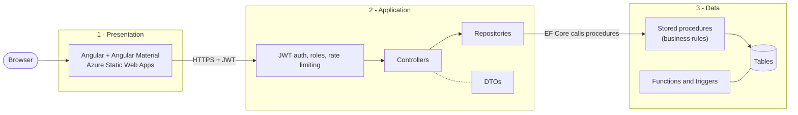
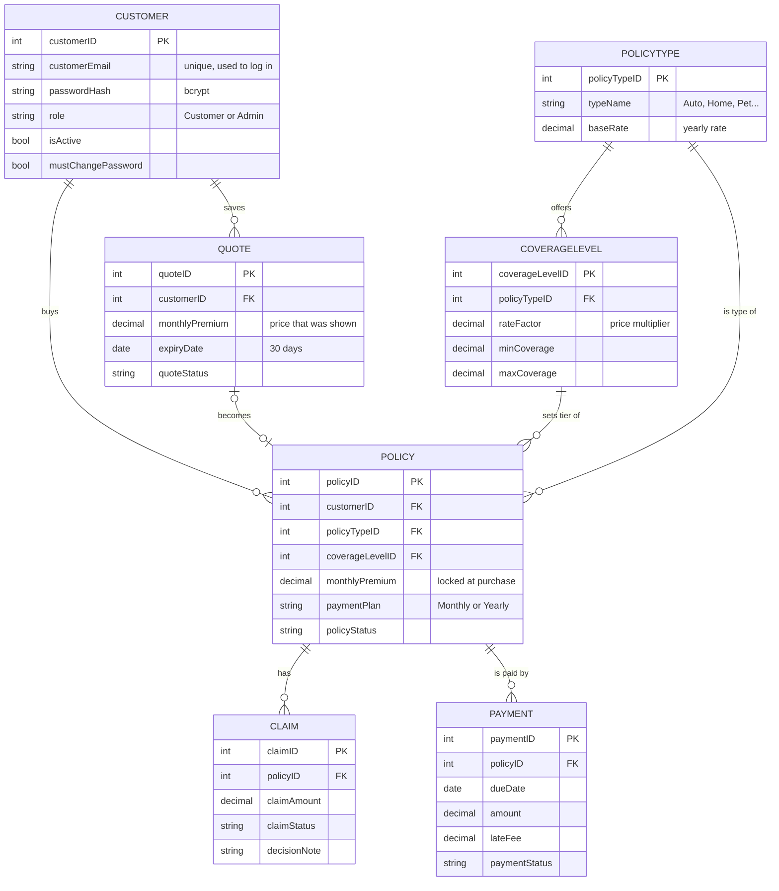
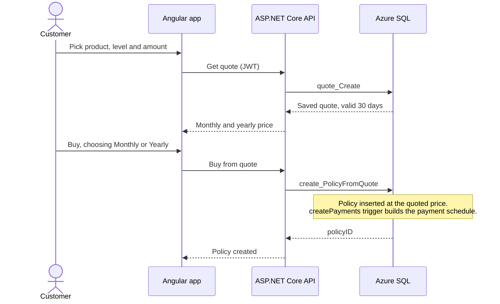
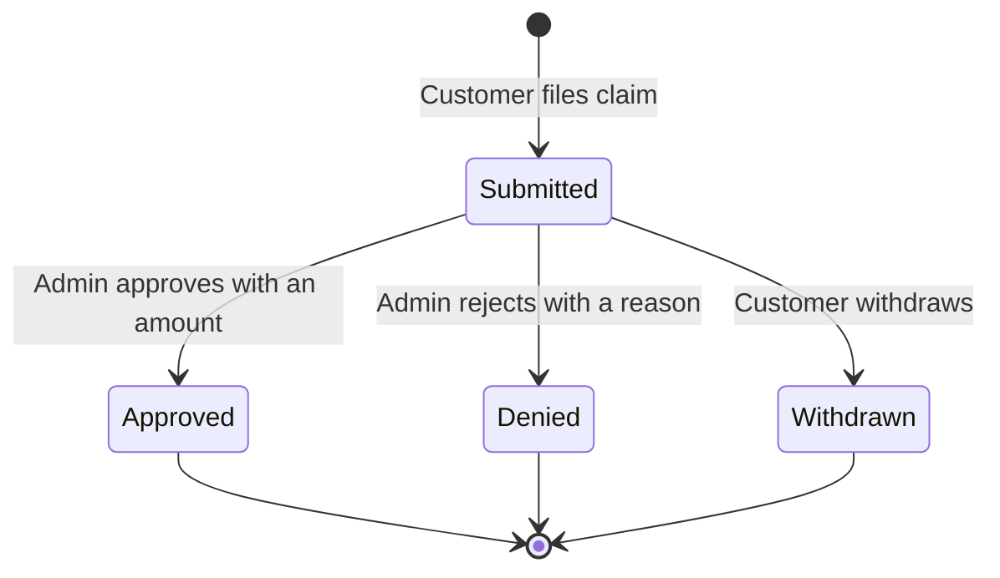

# DucklingInsurance

A full-stack insurance platform where customers get quotes, buy policies, pay, and file claims, and an admin runs the back office. It is a three-tier app (Angular, ASP.NET Core Web API, Azure SQL), built database-first and deployed on Azure.

**Live demo:** [Insurance App](https://purple-ground-0651bcf1e.6.azurestaticapps.net)

> The API runs on Azure's free App Service tier, so the first request after a quiet period can take 30 seconds or more while it wakes up. Give it a moment and refresh.

Built by **Khalon Rodney**.

---

## Contents

- [Features](#features)
- [Architecture](#architecture)
- [Tech stack](#tech-stack)
- [Data model](#data-model)
- [How a purchase works](#how-a-purchase-works)
- [Business rules](#business-rules)
- [Security](#security)
- [Project structure](#project-structure)
- [Getting started](#getting-started)
- [Creating the admin account](#creating-the-admin-account)
- [Deploying to Azure](#deploying-to-azure)
- [Known limitations](#known-limitations)
- [Future enhancements](#future-enhancements)

---

## Features

### Customers
- Register and log in, edit contact details, change password, and close their own account
- Eight products, each with coverage levels and plain-English descriptions: **Auto, Motorcycle, Home, Renters, Health, Life, Pet, Travel**
- Instant price quotes. Every quote is saved for 30 days and can be bought later at the price that was shown
- Choose **Monthly** (12 payments) or **Yearly** (one payment with a 5% discount) when buying
- Change coverage level or amount, or cancel a policy
- Pay installments (simulated), with a confirmation number on every paid payment
- Remaining balance, paid so far and next due date on each policy
- File claims on active policies and withdraw them while they are still open

### Admin
- View and search all customers (no passwords are ever shown), with active policies, open claims and overdue payments at a glance
- Edit a customer's name and date of birth, deactivate and reactivate accounts
- Reset a customer's password: a one-time temporary password is shown once, and the customer is forced to choose a new one at next login
- Approve claims (with an approved amount) or reject them (a reason is required)
- See every payment with the customer's contact details, overdue payments first
- See every saved quote
- Create new insurance products with their own coverage levels, rates and age factors, and see how many customers hold each product and who they are

Sensitive admin actions (edit, deactivate, reactivate, reset password, create product) require the admin to re-enter their password. Viewing data and deciding claims do not.

---

## Architecture



The request flow is: Angular, then the API (token and role checked), then a repository, then a stored procedure, then rows mapped into DTOs and returned as JSON.

- **Controllers** stay thin: they validate the request and call a repository.
- **Repositories** call stored procedures through EF Core (`SqlQuery` and `ExecuteSqlRaw`). EF Core is not used for LINQ-to-entities queries.
- **Stored procedures** hold the business rules, so they are enforced in one place no matter who calls them.
- **DTOs** describe the shape of requests and responses. Result columns map to DTO properties by name and type.

---

## Tech stack

| Layer | Technology |
|---|---|
| Frontend | Angular 21.2.28 (standalone components, signals, reactive forms), Angular Material |
| API | ASP.NET Core Web API on .NET 10.0, C# |
| Data access | Entity Framework Core 10.0.13 (used only to call stored procedures) |
| Database | Azure SQL / SQL Server, T-SQL stored procedures, functions and triggers |
| Auth | JWT bearer tokens (`Microsoft.AspNetCore.Authentication.JwtBearer` 10.0.13), BCrypt password hashing (`BCrypt.Net-Next` 4.2.0) |
| Validation | `libphonenumber-csharp` 9.0.41 for phone numbers |
| API docs | Swashbuckle.AspNetCore 10.3.1 (Swagger UI) |
| Hosting | Azure Static Web Apps (frontend), Azure App Service (API), Azure SQL Database |

---

## Data model



Soft status changes are used instead of deletes (cancelled, withdrawn, dismissed). "Overdue" and an expired quote are worked out when reading and are never stored.

---

## How a purchase works



The premium is calculated in SQL:

```
monthly premium = coverage x base rate x age factor x level factor / 12
yearly payment  = monthly premium x 12 x 0.95
```

A customer's age places them in one of three bands (under 25, 25 to 64, 65 and over), and each product has its own factor for each band.

Claims move through a simple lifecycle:



---

## Business rules

These live in the database, so they apply to every caller.

| Rule | Detail |
|---|---|
| Minimum age | Customers must be at least 18 |
| One policy per product | A customer can hold one current policy of each product; to get more coverage they change the one they have |
| Coverage ranges | Each coverage level has its own range. Three-tier products allow half, 1x and 2x of the product's maximum |
| Quotes | Valid for 30 days, usable once, and bought at the stored price even if rates change |
| Payment plans | Monthly creates 12 payments; Yearly creates one payment with a 5% discount. The plan is chosen at purchase |
| Yearly plan | A policy that is already paid for the year cannot change coverage until it renews |
| Overdue payments | Any overdue payment blocks changing coverage and cancelling a policy until it is paid |
| Late fees | $3 per day late, capped at 75% of the payment. The fee is stored when the payment is paid |
| Claims | Only on an active policy; the incident date must fall within the policy period; the amount cannot exceed the coverage |
| Rejecting a claim | The admin must give a reason |
| Deactivating an account | Blocked while the customer has an active policy, an open claim or an overdue payment. The admin account can never be deactivated |
| One admin | A unique database index allows only one admin account |

Dates use the Eastern time zone through `businessToday()` and `businessNow()`, because Azure SQL runs in UTC.

---

## Security

- **JWT authentication.** The token carries the user's ID and role. Roles are enforced on the server with `[Authorize(Roles = "Admin")]`. Angular reads the token only to decide what to show.
- **Password hashing.** Passwords are hashed with BCrypt, and no endpoint ever returns a hash.
- **Password re-entry.** Sensitive admin actions require the admin's password.
- **Forced password change.** After an admin reset, the token carries a flag. A middleware blocks every request except login, loading the profile and changing the password until the customer sets a new password.
- **Rate limiting.** Login and password-protected admin actions share an "auth" limiter of 5 requests per minute per IP.
- **CORS.** Allowed origins come from configuration.
- **Input validation.** Names, phone numbers, emails, dates and amounts are checked in the API and again by database constraints.
- **Error handling.** Custom SQL error numbers are mapped to HTTP status codes (for example 409 for a rule conflict and 404 for not found).

---

## Project structure

```
Revature-Projects/
└── Project 2 - insuranceAPP/
    ├── backend/            SQL scripts
    │   ├── ComprehensiveQuery.sql   Full database setup: tables, functions, triggers, procedures, seed data
    │   └── *.sql                    Earlier incremental scripts (quotes, overdue payments, coverage fixes...)
    ├── InsuranceApi/       ASP.NET Core Web API
    │   ├── Controllers/        Thin endpoints with role checks
    │   ├── Data/               DbContext and repositories that call the stored procedures
    │   ├── DTOs/               Request and response shapes
    │   ├── Models/             Entity classes
    │   ├── Services/           JWT tokens, phone formatting, SQL error mapping
    │   ├── Extensions/         ClaimsPrincipal helpers
    │   ├── appsettings.json    Non-secret configuration
    │   └── Program.cs          Auth, CORS, rate limiting and middleware setup
    ├── frontend/           Angular app
    │   ├── public/             Logo, favicon, Static Web Apps config
    │   └── src/
    │       ├── environments/   API URL per environment
    │       ├── styles/         Global theme and component styles
    │       └── app/
    │           ├── pages/          Customer pages
    │           │   └── admin/      Admin pages
    │           ├── layout/shell/   App shell and navigation
    │           ├── shared/         Dialogs and shared components
    │           ├── services/       HTTP services
    │           ├── models/         TypeScript models that mirror the DTOs
    │           ├── guards/         Route guards
    │           ├── interceptors/   Attaches the JWT to requests
    │           └── utils/          Helpers such as API error handling
    └── DucklingInsurance Presentation.pptx
```

---

## Getting started

### Prerequisites

- [.NET 10 SDK](https://dotnet.microsoft.com/download)
- [Node.js](https://nodejs.org/) and the Angular CLI (`npm install -g @angular/cli`)
- SQL Server, or an Azure SQL database

### 1. Set up the database

1. Create an empty database. On a local SQL Server, `ComprehensiveQuery.sql` creates one called `insuranceAppDB`. On Azure SQL, create the database in the portal first.
2. Run `backend/ComprehensiveQuery.sql` against it. It creates every table, function, trigger and stored procedure, and seeds the eight products and their coverage levels.

On Azure SQL Database, skip the `create database` and `use` lines at the top of the script and run the rest against your database.

### 2. Run the API

```bash
cd InsuranceApi

# configure secrets (they are not stored in appsettings.json)
dotnet user-secrets init
dotnet user-secrets set "ConnectionStrings:InsuranceDb" "<your connection string>"
dotnet user-secrets set "Jwt:Key" "<a long random string, at least 32 characters>"

dotnet run
```

The other settings are in `appsettings.json`:

```json
{
  "Jwt": { "Issuer": "InsuranceApi", "Audience": "InsuranceApp", "ExpiryMinutes": 60 },
  "Cors": { "AllowedOrigins": [ "http://localhost:4200" ] }
}
```

In development, Swagger UI is available so you can try the endpoints.

### 3. Run the frontend

```bash
cd frontend
npm install
```

Open `environment.ts` and set the API URL to the address your API is listening on (the URL `dotnet run` prints). Then:

```bash
ng serve
```

Open http://localhost:4200 and register an account.

---

## Creating the admin account

There is no default admin. Register a normal account in the app, then run this once against the database:

```sql
update Customer set [role] = 'Admin' where customerEmail = 'your-admin-email@example.com';
```

Log out and back in. The admin sees the admin pages instead of the customer pages. Only one admin can exist.

---

## Deploying to Azure

The project runs on three Azure services:

| Part | Service |
|---|---|
| Frontend | Azure Static Web Apps |
| API | Azure App Service |
| Database | Azure SQL Database |

**Database.** Run `ComprehensiveQuery.sql` against the Azure database (without the `create database` and `use` lines).

**API.** Add these application settings in the App Service configuration (double underscores stand in for `:`):

```
ConnectionStrings__InsuranceDb   <connection string>
Jwt__Key                         <long random string>
Cors__AllowedOrigins__0          https://<your-static-web-app>.azurestaticapps.net
```

Then publish and deploy:

```bash
cd InsuranceApi
dotnet publish -c Release -o ./publish
# zip the contents of ./publish, then:
az webapp deploy --resource-group <group> --name <app-name> --src-path <zip file> --type zip
```

**Frontend.** Point `environment.ts` at the deployed API, then build and deploy with the Static Web Apps CLI:

```bash
cd frontend
ng build --configuration production
swa deploy ./dist/<project-name>/browser --env production --deployment-token <token>
```

The deployment token is under **Manage deployment token** on the Static Web App in the Azure portal, or from `az staticwebapp secrets list`.

---

## Known limitations

- Payments are simulated. No real card or bank processing happens.
- A deactivated customer's token stays valid until it expires (up to 60 minutes), because there are no refresh tokens yet.
- Coverage changes apply to the whole policy period.
- Quotes keep their stored price even if an admin later edits the customer's date of birth.
- The free App Service tier cold-starts, so the first request can be slow.
- The layouts were built desktop-first and are not fully responsive yet.

---

## Future enhancements

- **Mobile experience:** responsive layouts for every page, including the admin tables
- **Stronger security:** two-factor authentication, email verification at sign-up, and refresh tokens so deactivation takes effect immediately
- **Real payments:** card, PayPal and check payments through a payment provider, automatic recurring payments and emailed receipts
- **Quality and operations:** automated tests, CI/CD with GitHub Actions, email notifications for claim decisions and payment reminders
- **Customer features:** a policy renewal flow, claim appeals and document uploads, and a downloadable policy ID card
